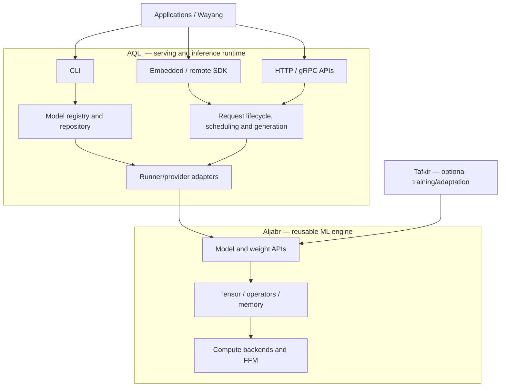

# AQLI — Java Inference Runtime

[](https://openjdk.org/projects/jdk/25/)
[](https://gradle.org/)
[](LICENSE)

AQLI is a Java-first inference runtime and serving product. It loads supported models, runs generation, manages inference requests and exposes CLI, SDK and service interfaces.

AQLI is the serving layer in the Andalus AI ecosystem:

- **[Aljabr](https://github.com/andalus-ai/aljabr)** provides reusable tensor, operator, model-format, backend and native-interoperability foundations.
- **AQLI** owns request lifecycle, generation policy, scheduling, model-serving operations, streaming and service interfaces.
- **[Tafkir](https://github.com/andalus-ai/tafkir)** focuses on training and adaptation. It is not a required dependency for ordinary AQLI inference.
- **[Wayang](https://github.com/bhangun/wayang)** and other application layers can consume AQLI as an inference service.

> **Capability status matters:** GGUF, Safetensors, ONNX, LiteRT, native-image and accelerator support depend on the specific runner, model, platform and build profile. A runner's existence does not by itself guarantee that every model is executable. The CLI's quantization command must not be considered production-ready unless it is connected to a real quantization implementation.

## Contents

- [Architecture](#architecture)
- [Requirements](#requirements)
- [Quick start](#quick-start)
- [CLI examples](#cli-examples)
- [SDK example](#sdk-example)
- [Observability](#observability)
- [Repository layout](#repository-layout)
- [Documentation](#documentation)
- [Build and validation](#build-and-validation)
- [License](#license)

## Architecture



**Boundary rule:** Aljabr must not depend on AQLI. AQLI may depend on Aljabr's public APIs. Training-only integrations remain optional and must not leak into the default inference classpath.

## Requirements

- JDK 25 for the documented baseline.
- The Gradle Wrapper included in the repository.
- macOS/Apple Silicon for Metal-specific paths, or a supported Linux/CPU/CUDA setup for those paths.
- GraalVM 25 only if building the native-image CLI.

Native libraries and hardware-specific backends are optional and platform-dependent. Follow the relevant runner documentation for prerequisites.

## Quick start

### Install

Use the installer only after reviewing it and confirming it matches the current branch/release:

```bash
curl -fsSL https://raw.githubusercontent.com/andalus-ai/aqli/main/scripts/install.sh -o install-aqli.sh
less install-aqli.sh
bash install-aqli.sh
```

### Build from source

```bash
git clone https://github.com/andalus-ai/aqli.git
cd aqli
./gradlew projects
```

To build the CLI JVM artifact, use the current CLI module task listed by the Gradle project graph and its module README. For example, the repository has used:

```bash
./gradlew :ui:aqli-cli:quarkusBuild
```

A native-image build additionally requires GraalVM 25 and may have runner-specific native configuration. Build tasks and optional modules can change; check the wrapper and module docs before relying on a command in a release pipeline.

## CLI examples

After installing or building the CLI, examples of the intended command interface are:

```bash
# Interactive chat
aqli chat --model <model-id>

# Download a model
aqli pull hf:Qwen/Qwen2.5-7B-Instruct-GGUF

# List available local models
aqli list

# Filter by task category, when supported by the selected CLI build
aqli list --task-type vision

# Single-shot inference
aqli run --model <model-id> --no-banner --only-text --prompt "Hello"

# Start a service
aqli serve --model <model-id> --port 8080
```

Use `aqli --help` and `aqli <command> --help` as the source of truth for the installed CLI version. Options may differ between releases and experimental builds.

### Example: local GGUF inference

```bash
aqli run \
  --model hf:unsloth/gemma-4-12b-it-GGUF \
  --no-banner \
  --prompt "Who are you?" \
  --max-tokens 50
```

Model IDs, quantizations, backend availability and runtime flags depend on the selected model and host.

## SDK example

The exact artifact coordinates and method signatures are versioned with the published SDK. A minimal embedded usage pattern is:

```java
AqliSdk sdk = AqliSdkFactory.create(
    AqliSdkConfig.local().build()
);

InferenceResponse response = sdk.infer("qwen2.5-0.5b", request);
```

Check [API examples](docs/API_EXAMPLES.md) and the [API quick reference](docs/API_QUICK_REFERENCE.md) for complete imports, request construction, authentication, streaming and deployment examples.

## Observability

AQLI's observability modules can expose request duration, time-to-first-token, time-per-output-token, CPU and memory usage, and request outcomes. Available metrics and exporters depend on the selected runtime configuration.

See the [Observability Guide](docs/OBSERVABILITY.md). Avoid assuming a metric or exporter is enabled until verified in the running deployment.

## Repository layout

```text
framework/   Public contracts, SPI, SDKs, core abstractions and observability APIs
runtime/     Runtime lifecycle, model repositories, runner implementations and plugins
ui/          CLI and user-facing applications
scripts/     Build, installation, benchmark and development tooling
docs/        User guides, API references and architecture documents
```

The exact Gradle project graph is authoritative; use `./gradlew projects` when locating a module.

## Documentation

### Getting started and API

- [Quickstart](docs/QUICKSTART.md)
- [API Quick Reference](docs/API_QUICK_REFERENCE.md)
- [API Examples](docs/API_EXAMPLES.md)
- [Install Profiles](docs/install-profiles.md)
- [Error Codes](docs/error-codes.md)
- [Observability Guide](docs/OBSERVABILITY.md)
- [CLI documentation](ui/aqli-cli/README.md)

### Architecture and consolidation

- [System Architecture](docs/architecture/SYSTEM_ARCHITECTURE.md) — product roles, dependency direction, formats and lifecycle.
- [Sequence Flows](docs/architecture/SEQUENCE_FLOWS.md) — requests, model loading, generation, cancellation, shutdown and failure handling.
- [Module Ownership Matrix](docs/architecture/MODULE_OWNERSHIP_MATRIX.md) — canonical responsibility and migration checks.
- [Consolidation Roadmap](docs/architecture/ALJABR_AQLI_CONSOLIDATION_ROADMAP.md) — phased work and acceptance gates.
- [Ownership Audit](docs/architecture/ALJABR_AQLI_OWNERSHIP_AUDIT.md) — initial overlap inventory.

Architecture documents describe the target state and migration rules. They are not proof that every consolidation task or model capability is complete.

## Build and validation

Before submitting changes:

1. Run the focused module compile and tests for the affected code.
2. Run relevant repository CI and inspect failures rather than assuming a green workflow.
3. For cross-repository API changes, test both Gradle composite-build resolution and published Maven artifact resolution.
4. For runner changes, validate the affected model/format/backend combination and resource cleanup.
5. For performance changes, record model, prompt, hardware, warm-up, token count and before/after measurements.

## License

MIT. See [LICENSE](LICENSE).
