<div align="center">
  
  
  # Aqli Inference Engine
  
  [](https://jdk.java.net/25/)
  [](https://gradle.org/)
  [](https://opensource.org/licenses/MIT)
  [](https://www.graalvm.org/)
</div>

**Aqli** is a high-performance inference runtime and serving layer for AI models. It is a separate product from **Aljabr** (tensor and backend foundations) and **Tafkir** (training and model adaptation); these projects are complementary, not consolidated into one runtime.

Aqli acts as the inference foundation for the [Wayang](../wayang/) orchestration layer. Aqli owns model loading and execution, request scheduling, generation, KV-cache lifecycle, and serving across supported formats such as GGUF and SafeTensors. Aljabr provides reusable tensor operations, device and memory primitives, kernels, and quantized-tensor execution. Tafkir owns training-oriented workflows and model adaptation. Offline weight quantization is an optional workflow, not a requirement of Aqli's default inference runtime. The `aqli quantize` CLI command must not be treated as a production quantizer until it is wired to a real quantization engine.

## Architecture

```
┌─────────────────────────────────────────────────────┐
│                   Wayang (Agent Layer)              │
│          Orchestration · RAG · MCP · Tools          │
└───────────────────────┬─────────────────────────────┘
                        │  aqli-sdk / aqli-sdk-api
┌───────────────────────▼─────────────────────────────┐
│              Aqli (Inference Engine)              │
│                                                     │
│  ┌──────────┐  ┌──────────┐  ┌───────────────────┐ │
│  │  GGUF    │  │SafeTensor│  │  LiteRT / ONNX    │ │
│  │  Runner  │  │  Runner  │  │     Runners       │ │
│  └──────────┘  └──────────┘  └───────────────────┘ │
│                                                     │
│  ┌──────────────────────────────────────────────┐  │
│  │         aljabr (tensor core)            │  │
│  │  CPU · Metal (Apple Silicon) · CUDA          │  │
│  └──────────────────────────────────────────────┘  │
└─────────────────────────────────────────────────────┘

```




```mermaid
%% Generated by https://gitdiagram.com/bhangun/aqli
flowchart TD

subgraph group_clients["Clients and Serving"]
  node_cli["CLI"]
  node_sdk["SDK Chat"]
  node_api["API Server"]
  node_grpc["gRPC Service"]
end

subgraph group_models["Model Management"]
  node_model_registry["Model Registry"]
  node_model_download["Model Download"]
  node_hf_repo["Hugging Face"]
end

subgraph group_inference["Inference Runtime"]
  node_request["Inference Request"]
  node_engine_spi["Inference SPI"]
  node_runtime["Execution Runtime"]
  node_prefill_decode["Prefill Decode"]
  node_core["Tensor and IR Core<br/>[GValueId.java]"]
  node_response["Inference Result"]
end

subgraph group_backends["Execution Backends"]
  node_gguf["GGUF Runner"]
  node_safetensor["SafeTensor Runner"]
  node_onnx["ONNX Runner<br/>[OnnxEngine.java]"]
  node_litert["LiteRT Runner"]
  node_torch["LibTorch Runner"]
end

subgraph group_operations["Operations"]
  node_observability["Metrics and Audit"]
end

node_user(("User"))

node_user -->|"invokes"| node_cli
node_user -->|"uses"| node_sdk
node_user -->|"starts"| node_api
node_cli -->|"pulls models"| node_model_download
node_model_download -->|"downloads from"| node_hf_repo
node_cli -->|"lists models"| node_model_registry
node_sdk -->|"builds request"| node_request
node_sdk -.->|"submits inference"| node_engine_spi
node_grpc -->|"serves inference"| node_engine_spi
node_api -.->|"serves inference"| node_engine_spi
node_request -->|"specifies input"| node_engine_spi
node_engine_spi -.->|"executes via"| node_runtime
node_runtime -->|"uses operators"| node_core
node_runtime -.->|"dispatches to"| node_safetensor
node_runtime -.->|"dispatches to"| node_gguf
node_runtime -.->|"dispatches to"| node_onnx
node_runtime -.->|"dispatches to"| node_litert
node_runtime -.->|"dispatches to"| node_torch
node_prefill_decode -->|"reads request"| node_request
node_prefill_decode -.->|"produces output"| node_response
node_engine_spi -->|"returns result"| node_response
node_engine_spi -.->|"reports metrics"| node_observability

click node_cli "https://github.com/bhangun/aqli/tree/main/ui/aqli-cli"
click node_sdk "https://github.com/bhangun/aqli/blob/main/framework/sdk/aqli-sdk-core/src/main/java/tech/kayys/aqli/sdk/core/AqliChatService.java"
click node_api "https://github.com/bhangun/aqli/tree/main/ui/aqli-api"
click node_grpc "https://github.com/bhangun/aqli/blob/main/ui/aqli-sdk-protobuf/src/main/java/tech/kayys/aqli/protobuf/AqliGrpcService.java"
click node_model_registry "https://github.com/bhangun/aqli/blob/main/framework/repository/aqli-model-database/src/main/java/tech/kayys/aqli/model/registry/ModelRegistryService.java"
click node_model_download "https://github.com/bhangun/aqli/blob/main/framework/repository/aqli-model-database/src/main/java/tech/kayys/aqli/model/domain/download/ModelDownloadManager.java"
click node_hf_repo "https://github.com/bhangun/aqli/blob/main/runtime/repository/aqli-model-repo-hf/src/main/java/tech/kayys/aqli/model/repo/hf/HuggingFaceRepository.java"
click node_request "https://github.com/bhangun/aqli/blob/main/framework/spi/aqli-spi-inference/src/main/java/tech/kayys/aqli/spi/inference/InferenceRequest.java"
click node_engine_spi "https://github.com/bhangun/aqli/blob/main/framework/spi/aqli-spi-inference/src/main/java/tech/kayys/aqli/spi/inference/InferenceEngine.java"
click node_runtime "https://github.com/bhangun/aqli/blob/main/runtime/core/aqli-runtime-core/src/main/java/tech/kayys/aqli/runtime/ExecutionEngine.java"
click node_prefill_decode "https://github.com/bhangun/aqli/blob/main/runtime/optimization/aqli-plugin-prefill-decode/src/main/java/tech/kayys/aqli/prefilldecode/PrefillDecodeDisaggService.java"
click node_core "https://github.com/bhangun/aqli/blob/main/framework/core/aqli-core/src/main/java/tech/kayys/aqli/ir/GValueId.java"
click node_gguf "https://github.com/bhangun/aqli/tree/main/runtime/runner/gguf/aqli-runner-gguf"
click node_safetensor "https://github.com/bhangun/aqli/tree/main/runtime/runner/safetensor/aqli-safetensor-engine"
click node_onnx "https://github.com/bhangun/aqli/blob/main/runtime/runner/onnx/aqli-runner-onnx/src/main/java/tech/kayys/aqli/provider/onnx/OnnxEngine.java"
click node_litert "https://github.com/bhangun/aqli/tree/main/runtime/runner/litert/aqli-runner-litert"
click node_torch "https://github.com/bhangun/aqli/blob/main/runtime/runner/torch/aqli-runner-libtorch/src/main/java/tech/kayys/aqli/inference/libtorch/LibTorchEngine.java"
click node_observability "https://github.com/bhangun/aqli/tree/main/framework/observability/aqli-observability"
click node_response "https://github.com/bhangun/aqli/blob/main/framework/spi/aqli-spi-inference/src/main/java/tech/kayys/aqli/spi/inference/InferenceResponse.java"

classDef toneNeutral fill:#f8fafc,stroke:#334155,stroke-width:1.5px,color:#0f172a
classDef toneBlue fill:#dbeafe,stroke:#2563eb,stroke-width:1.5px,color:#172554
classDef toneAmber fill:#fef3c7,stroke:#d97706,stroke-width:1.5px,color:#78350f
classDef toneMint fill:#dcfce7,stroke:#16a34a,stroke-width:1.5px,color:#14532d
classDef toneRose fill:#ffe4e6,stroke:#e11d48,stroke-width:1.5px,color:#881337
classDef toneIndigo fill:#e0e7ff,stroke:#4f46e5,stroke-width:1.5px,color:#312e81
classDef toneTeal fill:#ccfbf1,stroke:#0f766e,stroke-width:1.5px,color:#134e4a
class node_cli,node_sdk,node_api,node_grpc,node_user toneBlue
class node_model_registry,node_model_download,node_hf_repo toneAmber
class node_request,node_engine_spi,node_runtime,node_prefill_decode,node_core,node_response toneMint
class node_gguf,node_safetensor,node_onnx,node_litert,node_torch toneRose
class node_observability toneIndigo
```

## Prerequisites

- **Java 25** (GraalVM for native image, Temurin for JVM)
- **Gradle 9.x** (wrapper included)
- **macOS** (Apple Silicon, Metal acceleration) or **Linux** (CPU / CUDA)

Optional:
- `graalvm-ce-25` for `buildNative`
- `llama.cpp` source (auto-prepared by `scripts/prepare-llama-source.sh`)

## Quick Start

### Install via script

```bash
curl -sSL https://raw.githubusercontent.com/kayys-tech/aqli/main/scripts/install.sh | bash
```

### Build from source

```bash
git clone https://github.com/kayys-tech/aqli.git
cd aqli

# Build JVM jar
./gradlew :ui:aqli-cli:quarkusBuild -x test

# Build native binary (requires GraalVM 25)
./gradlew :ui:aqli-cli:buildNative -x test
```

### Run the CLI

```bash
# Interactive chat
aqli chat --model <modelId>

# Pull a model from HuggingFace (task type auto-detected)
aqli pull hf:Qwen/Qwen2.5-7B-Instruct-GGUF

# Pull a vision model
aqli pull hf:HuggingFaceTB/SmolVLM-256M-Instruct

# List models with task-type grouping
aqli list

# Filter by task category
aqli list --task-type vision
aqli list --task-type stt

# Single-shot inference (clean output for scripts)
aqli run --model <id> --no-banner --no-info --only-text --prompt "Hello"

# Start the API server
aqli serve --model <id> --port 8080

# Check system info and resource utilization
aqli system info
```

## CLI Reference

See the full [CLI README](ui/aqli-cli/README.md) for all commands and flags. Key highlights:

### Model task-type grouping

Every model downloaded via `aqli pull` is automatically tagged with a **task type** derived from the
HuggingFace `pipeline_tag`:

| HuggingFace tag | Aqli task type |
|-----------------|------------------|
| `text-generation`, `conversational` | `text` |
| `automatic-speech-recognition`, `audio-classification` | `stt` |
| `text-to-speech`, `text-to-audio` | `tts` |
| `image-to-text`, `image-classification`, `object-detection` | `vision` |
| `feature-extraction`, `sentence-similarity` | `embedding` |

```bash
aqli list              # shows TASK column
aqli list -t vision    # filter by category
aqli pull hf:myorg/my-tts-model --task-type tts  # override
```


### Clean output flags for scripting

```bash
aqli run --model <id> \
  --no-banner   \   # suppress ASCII banner
  --no-info     \   # suppress model/provider line
  --only-text   \   # print only the assistant text
  --prompt "..."
```


## Example Usage

```bash
aqli run --model hf:unsloth/gemma-4-12b-it-GGUF --no-banner --prompt --java "who are you" --max-tokens 50
```


```bash
aqli run --model hf:unsloth/gemma-4-12b-it-GGUF --no-banner --prompt "what is indonesia" 

Resolved local model index entry: /Users/bhangun/.aqli/models/blobs/unsloth/gemma-4-12b-it-GGUF/unsloth__gemma-4-12b-it-GGUF/gemma-4-12b-it-Q4_K_M.gguf
Model: /Users/bhangun/.aqli/models/blobs/unsloth/gemma-4-12b-it-GGUF/unsloth__gemma-4-12b-it-GGUF/gemma-4-12b-it-Q4_K_M.gguf
Provider: gguf, format=gguf
Execution route: gguf (backend=MTL0 (Apple M4)) [llama_cpp_gguf_daemon]
--------------------------------------------------
Using llama.cpp GGUF daemon for gemma-4-12b-it-Q4_K_M.gguf (backend=MTL0 (Apple M4), nGpuLayers=-1, threads=4, context=4096, batch=1024, ubatch=512, swaFull=false, cpuFallback=false, session=warm-exact).
Indonesia is a sovereign archipelagic country in Southeast Asia, consisting of over 17,000 islands. It is the world's largest island country and the most populous nation in Southeast Asia.
[Fast GGUF, Duration: 4,40s, Speed: 10,45 t/s]
Performance Metrics:
  open time      =      0,96 ms
  generate call  =   4379,55 ms
  generation     =     10,50 t/s (46 tokens)
  token latency  =     95,21 ms/token
  native backend = MTL0 (Apple M4) (gpuLayers=-1, threads=4, ctx=4096, batch=1024)
  native load    =      0,01 ms, context init = 376,08 ms
  native tokenize=     37,40 ms (miss)
  native prompt  =    296,38 ms (20 tokens)
  native decode  =   4041,33 ms (46 sampled, 46 decoded)
  native sampler = reused, 0,33 ms
  native session = warm (exact)
  native cache   = stored, 259,03 ms (eager-short)
  native output  = 216 bytes, java buffer = 1048576 bytes, retries = 0
```

## SDK Usage

```java
// Embedded SDK with built-in resource metrics
AqliSdk sdk = AqliSdkFactory.create(
    AqliSdkConfig.local()
        .observability(SdkObservabilityProvider.withResourceMetrics())
        .build()
);

// Infer
InferenceResponse response = sdk.infer("qwen2.5-0.5b", request);

// Check resource utilization (for capacity planning)
SdkMetricsCollector.ResourceSnapshot resources = sdk.getResourceSnapshot();
System.out.printf("CPU: %.1f%% | Heap: %dMB / %dMB%n",
    resources.processCpuLoad() * 100,
    resources.heapUsedBytes() / 1_048_576,
    resources.heapMaxBytes() / 1_048_576);
```

## Observability

Aqli exposes metrics for capacity planning via:

| Metric | Description |
|--------|-------------|
| `aqli.resource.cpu.process.load` | JVM process CPU load (0-1) |
| `aqli.resource.cpu.system.load` | System-wide CPU load (0-1) |
| `aqli.resource.memory.heap.used` | JVM heap used (bytes) |
| `aqli.resource.memory.heap.max` | JVM heap max (bytes) |
| `aqli.inference.request.cpu.seconds` | CPU time per request (histogram) |
| `aqli.inference.request.memory.delta` | Heap delta per request (histogram) |
| `aqli.inference.duration` | Request latency (histogram) |
| `aqli.inference.ttft` | Time-to-first-token (histogram) |
| `aqli.inference.tpot` | Time-per-output-token (histogram) |

Metrics are exported via Micrometer (Prometheus-compatible) when running as a server.

## Logging

Aqli writes structured JSON logs to `~/.aqli/logs/aqli.log` by default.

```bash
# Override log directory
export AQLI_LOG_DIR=/var/log/aqli
aqli start
```

The JSON format is compatible with Fluentd, Logstash, Loki, and Elasticsearch.

## Project Structure

```
Families/Aqli/aqli/
├── framework/                 # Pure Abstractions & Contracts
│   ├── core/                  # Canonical IR (AqliGraph, GOp) & GTensor/GData
│   ├── spi/                   # Service Provider Interfaces (Runner, Inference, Multimodal)
│   ├── plugin/                # Plugin core interfaces & lifecycle managers
│   ├── sdk/                   # aqli-sdk, sdk-api, sdk-core, sdk-remote, sdk-protobuf
│   └── observability/         # Common telemetry, metrics, and health interfaces
├── runtime/                   # Concrete Execution & Implementations
│   ├── core/                  # ServingLoop, Scheduler, PagedKVCache, Prefill/Decode
│   ├── runner/                # Concrete runners (GGUF, SafeTensor, LiteRT, ONNX, LibTorch)
│   ├── repository/            # Concrete model repos (HF, Kaggle, Local) & Model Database
│   ├── sdk/                   # aqli-sdk-local (embedded local engine SDK provider)
│   ├── plugins/               # Feature plugins (Prompt, Sampling, Reasoning, Streaming)
│   ├── optimization/          # Performance plugins (FlashAttention, QLoRA, EvicPress)
│   └── adapter/               # Compatibility adapters
├── ui/
│   └── aqli-cli/            # Quarkus-based CLI (JVM + native image)
├── scripts/                   # Tooling, benchmarking, and build automation
└── docs/                      # Extended documentation
```

## Docs

- [Quickstart](docs/QUICKSTART.md)
- [API Quick Reference](docs/API_QUICK_REFERENCE.md)
- [Observability Guide](docs/OBSERVABILITY.md)
- [API Examples](docs/API_EXAMPLES.md)
- [Error Codes](docs/error-codes.md)
- [Install Profiles](docs/install-profiles.md)

## License

MIT © Kayys.tech
