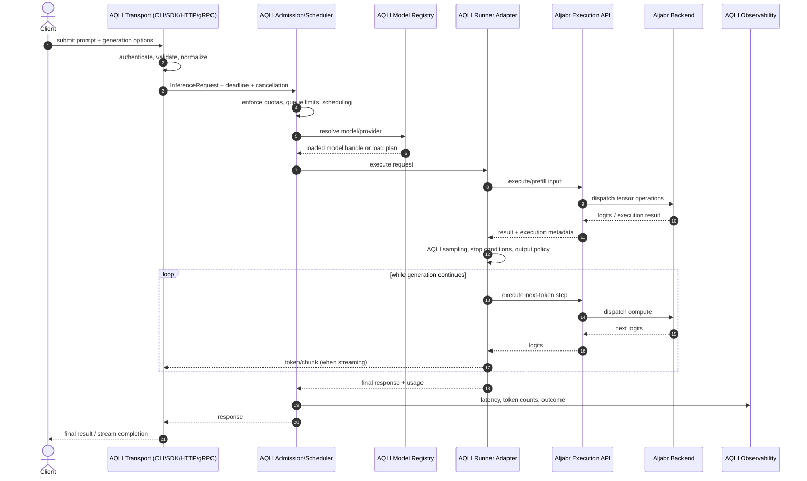
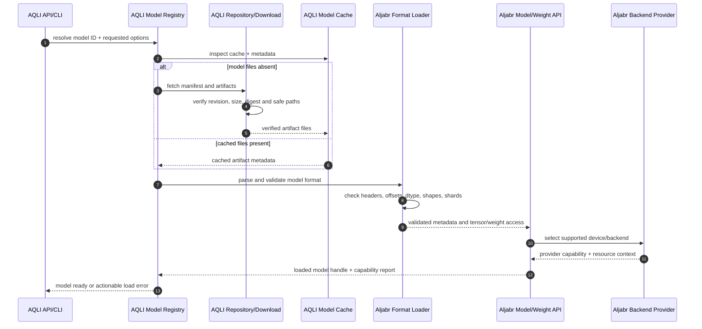
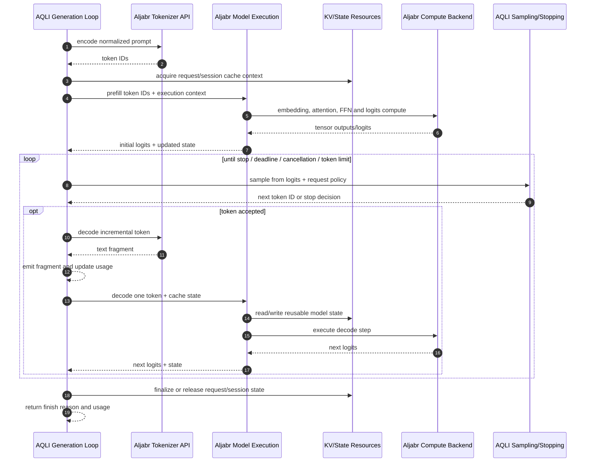
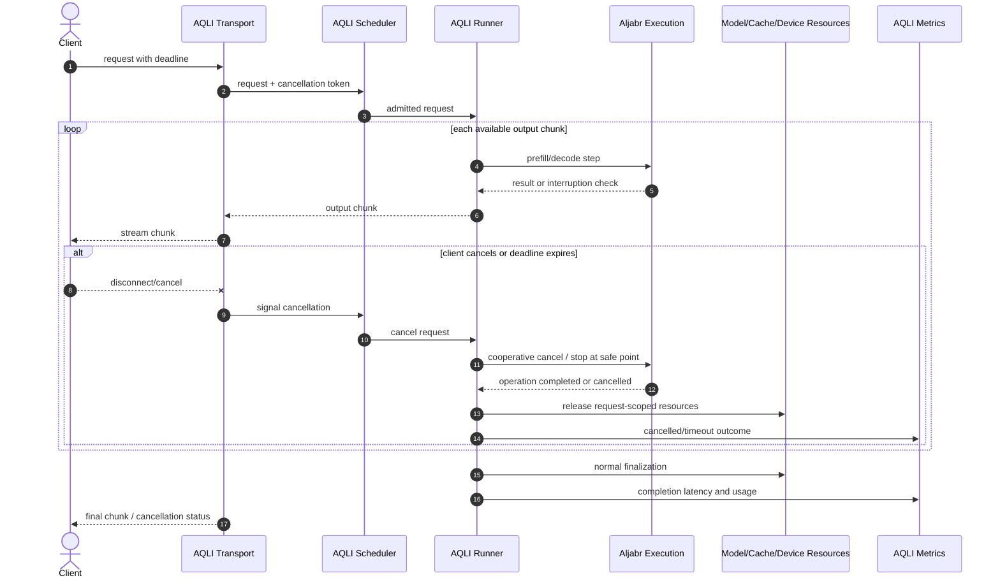
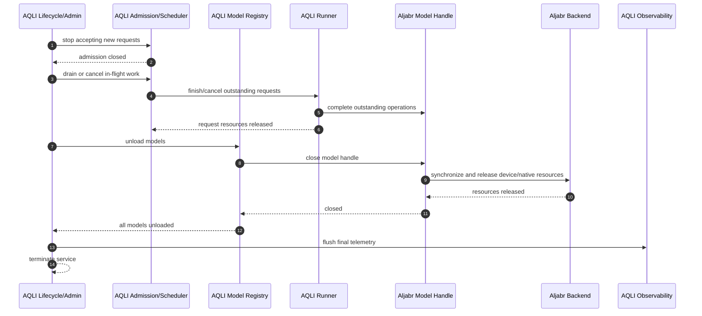
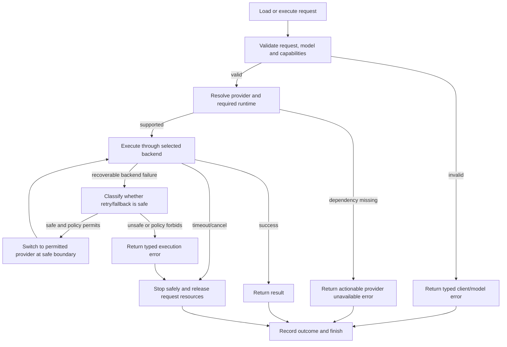
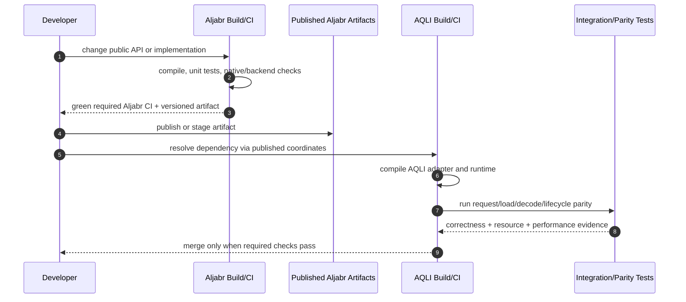

# Aljabr–AQLI Sequence Flows

**Baseline:** 2026-10-28  
**Purpose:** Specify intended runtime interactions and failure/cleanup behavior. These diagrams describe the target flow; concrete class names may vary while consolidation is in progress.

## 1. Request from API to response

**Boundary:** Aljabr executes reusable model/tensor work. AQLI decides whether and when to accept a request, how to sample, when to stop, how to stream and how to account for it. If Aljabr exposes a complete decode API for a supported model, AQLI still owns serving policy around that API.

## 2. Model discovery and loading

**Requirements:** downloading and format parsing are distinct stages. Never trust an unverified cache entry. On any partial failure, close mapped files and native/device allocations. Record model revision, format, provider, quantization and relevant runtime versions so a result is reproducible.

## 3. Token-by-token generation

KV cache ownership must be explicit: Aljabr may own storage/layout primitives and backend-safe state handles; AQLI owns request/session policy, admission, reuse eligibility, tenant isolation and eviction policy. If current implementations combine these concerns, split them only after cache parity and lifecycle tests exist.

## 4. Streaming, cancellation and deadlines

Cancellation must not free native/device memory while an in-flight operation can still access it. Cancellation should be cooperative at documented safe points; deadline expiry must be distinguished from client cancellation and model/backend failure.

## 5. Shutdown and model unload

Shutdown ordering is important: stop admission first, drain/cancel requests, then release model/backend resources. Never unload a model while requests still hold live references unless the model API provides safe reference-counted lifetime semantics.

## 6. Failure and fallback policy

Fallback is not automatic for every error. It must be explicit in the request/provider policy and safe with respect to model format, quantization, state, numerical behavior and performance expectations. Do not hide ABI errors or incorrect outputs behind a fallback that makes the run appear successful.

## 7. Cross-repository integration and build sequence

During development, composite builds are useful, but they are not sufficient: run at least one published-artifact resolution check to catch missing modules, incorrect coordinates, and hidden source-tree coupling.

## 8. Minimum sequence-level test matrix

| Flow | Positive case | Negative case | Lifecycle assertion |
|---|---|---|---|
| Request | valid prompt, streaming and non-streaming | invalid options / unsupported model | request state released |
| Model load | cached and fresh download | malformed metadata, digest mismatch, missing runtime | partial allocations closed |
| Decode | greedy and sampled generation | backend failure, invalid logits | cache state remains consistent |
| Cancellation | client cancel and deadline | cancellation during prefill/decode | no use-after-free; resources eventually released |
| Unload | idle model and drained model | unload requested while active | reference/lifecycle rules enforced |
| Fallback | allowed compatible provider | ABI mismatch / unsupported quantization | no silent unsafe fallback |
| Build integration | composite and published artifacts | missing optional dependency | default inference remains buildable |

## 9. Diagram maintenance

When implementation changes, update these flows alongside public API changes. If the implementation differs from the target, document the deviation and its migration step rather than drawing an idealized diagram as if it were already implemented.
