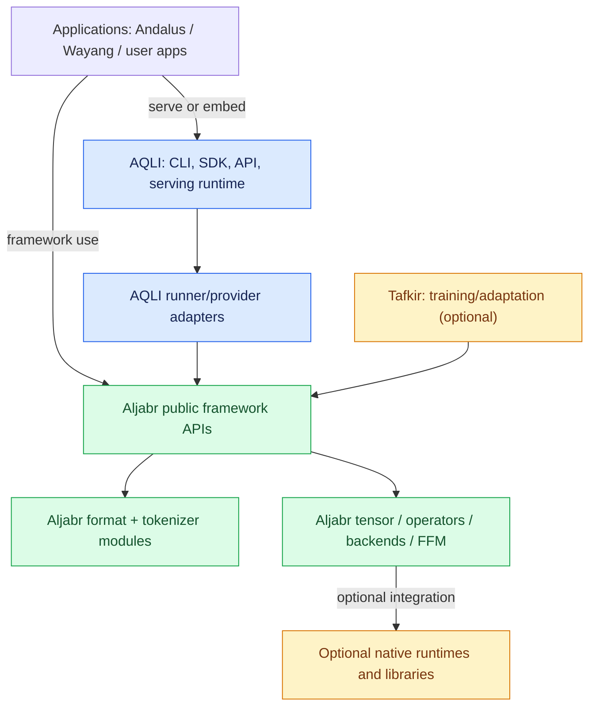

# Aljabr–AQLI System Architecture

**Architecture baseline:** 2026-10-28  
**Java baseline:** JDK 25  
**Status:** Target architecture and migration contract; this document does not assert that every target component is already implemented or passing CI.

## 1. Purpose

This document defines the durable system boundary between Aljabr, AQLI, and Tafkir. It is the architectural reference for code placement, dependencies, module consolidation, API design, release sequencing, and acceptance tests.

The governing rule is **one canonical implementation per responsibility**. Similar names are only a reason to investigate; they are not proof of duplicate behavior. Replace or remove an implementation only after public API, behavior, error semantics, resource lifecycle, performance, and compatibility have been verified.

## 2. Product roles

### Aljabr — reusable Java ML framework

Aljabr is the Java-first ML engine/library intended for research, development, education, and application building. Its target includes tensor programming and neural-network primitives, reusable model topology and execution, compute dispatch, memory abstractions, model formats, tokenizer contracts, and native interoperability.

Aljabr should be independently usable by a Java application without starting an AQLI server or requiring AQLI runtime modules.

**Owns:**
- Tensor values, shapes, dtypes, strides/layouts, storage, views, device placement, and explicit memory/resource lifetime.
- Generic operators, kernels, compute graphs/IR where framework-generic, and backend dispatch.
- CPU/vector and supported accelerator backends (Metal, CUDA, ROCm, and others only where implemented and tested).
- Reusable neural-network primitives and model-family/topology definitions.
- Format-level parsing, validation, loading, and reusable conversion for GGUF and Safetensors.
- ONNX and LiteRT integrations through explicit optional runtime adapters; parsing and execution are separate capabilities.
- Generic tokenizer SPI and reusable tokenizer implementations.
- FFM-based Java/native APIs, generated ABI declarations, native library discovery and low-level native resource ownership.
- Generic model-execution contracts that are useful outside a serving product.

**Does not own:**
- HTTP endpoints, OpenAI-compatible routing, gRPC server configuration, CLI commands, tenant policy, request admission, queue management, service health/admin endpoints, deployment policy, or server shutdown orchestration.
- AQLI-specific streaming protocol adaptation, request IDs, rate limits, auth, billing, and operational controls.
- Training orchestration that belongs to Tafkir.

### AQLI — inference runtime and serving product

AQLI turns model capabilities into a usable inference service or embedded inference runtime. It coordinates requests, chooses a supported runner, controls generation, and exposes product-facing APIs.

**Owns:**
- CLI, serving SDK/facade, HTTP/OpenAI-compatible APIs and gRPC endpoints.
- Request validation, admission control, quotas, queueing, batching/scheduling, routing, cancellation and deadlines.
- Generation policy: sampling configuration, stopping criteria, token streaming/response mapping, conversation/session policy, and request-level KV-cache coordination.
- Model registry/repository integration, download and cache policy, deployment configuration, model selection and reload policy.
- Runtime lifecycle, health/admin operations, graceful shutdown and failure recovery.
- Authentication/authorization integration, tenant isolation, metrics, tracing, audit events and operational limits.
- Runner/provider selection and thin adapters mapping AQLI contracts to Aljabr's public APIs.
- AQLI-specific model-serving integration where no Aljabr equivalent exists yet, until migration parity is proven.

**Must not own as a second canonical implementation:**
- Generated llama.cpp/ggml FFM declarations.
- A generic tensor API, general-purpose compute backend, or duplicate format parser/validator.
- A reusable tokenizer contract when Aljabr provides an equivalent stable API.
- A second implementation of native ABI layouts and low-level ownership already exposed by Aljabr.

### Tafkir — optional training and adaptation

Tafkir owns training workflows, fine-tuning, optimizer/training-loop orchestration, and training-oriented adaptation. It may integrate with Aljabr's tensor/autograd/backends.

AQLI's ordinary inference build must not require Tafkir. Quantization or adaptation that uses Tafkir must be an optional integration, plugin, or separately selected build/runtime capability. AQLI should express optional inference-time capabilities through AQLI-owned ports or stable Aljabr contracts, not leak a mandatory training dependency into its core.

### Andalus / Wayang — application and orchestration

Higher-level agent, workflow, tool, MCP, RAG, ERP and enterprise orchestration belongs above AQLI. These applications consume AQLI's serving API or Aljabr directly for framework-level use cases; Aljabr must not depend on those applications.

## 3. Dependency direction

Target dependency graph:

Rules:
1. AQLI may depend on Aljabr public APIs; Aljabr must not depend on AQLI.
2. Tafkir may depend on Aljabr. AQLI may optionally integrate with Tafkir only through an optional module/adapter.
3. An Aljabr module must not require a sibling checkout of AQLI to compile.
4. Default AQLI inference must not resolve training-only artifacts merely to load or run a model.
5. Product-facing AQLI modules may depend on server frameworks; Aljabr core modules should not acquire those dependencies just because an endpoint currently lives in an Aljabr-named module.
6. Optional backends and formats must fail with actionable capability errors, not make the core dependency graph fail to resolve.
7. No module should depend on a private implementation package of another module when a stable public SPI exists.

## 4. Layered request path

A normal serving request should pass through these layers:

1. **Transport:** CLI, SDK, HTTP or gRPC accepts input and authenticates it.
2. **Serving contract:** normalize prompt/messages, generation parameters, deadline, cancellation token and requested output mode.
3. **Admission/scheduling:** enforce quotas and limits, queue or batch work, choose a compatible runner.
4. **Model/session resolution:** select a loaded model, acquire a request/session context and initialize or reuse cache state.
5. **AQLI adapter:** translate the request into Aljabr's generic execution API and map errors/results back.
6. **Aljabr execution:** validate model/weights, run tensor operators and dispatch kernels to a selected backend.
7. **Generation loop:** AQLI applies sampling/stopping/streaming policy to logits or generated tokens. Reusable math may be provided by Aljabr; policy stays in AQLI.
8. **Response:** stream or return output, record metrics, release request-scoped resources and finalize state.

The exact boundary between logits production and token selection must be explicit in the public contract. Do not couple Aljabr to HTTP streaming or AQLI's request classes.

## 5. Model format and execution boundaries

### GGUF

- Aljabr owns GGUF metadata/tensor parsing, low-level llama.cpp/ggml FFM declarations, ABI layouts, native binding lifecycle, and reusable low-level backend operations.
- AQLI owns model selection, serving-level load/unload policy, generation settings, cancellation, streaming and metrics.
- AQLI can retain a thin runner adapter. It should not retain a second generated binding tree or duplicate handwritten native loader once Aljabr's API is proven equivalent.
- Native-library absence, ABI mismatch and unsupported model/backend combinations need stable, testable errors.

### Safetensors

- Aljabr owns header parsing, metadata/offset/dtype/shape validation, sharded-file reading and reusable tensor/weight loading.
- Aljabr owns reusable tensor operators and accelerator dispatch.
- AQLI owns the serving runner, generation loop, request/session state and serving-specific KV-cache policy.
- The current AQLI Safetensors engine contains substantial execution behavior. The existence of an Aljabr loader does **not** mean that the entire engine can be deleted. Audit class-by-class and migrate only when equivalent execution and resource semantics exist.
- The default path should favor Java/FFM and must not require LibTorch. LibTorch can remain an explicitly optional fallback while the Java path matures.

### ONNX and LiteRT

- Separate format/model inspection from graph execution and from serving.
- Aljabr defines optional integration contracts and capability reporting; actual graph execution requires the selected runtime and supported operators.
- AQLI selects the provider, applies serving policy and normalizes results/errors.
- Documentation must distinguish “format can be inspected/loaded” from “model can execute on backend X.”

### Tokenizers and templates

- Aljabr owns generic tokenizer contracts and reusable algorithm implementations.
- AQLI owns request-time prompt assembly and serving protocol policy.
- Chat-template parsing/formatting should have a clearly assigned owner and versioned contract; avoid duplicate special-token rules.
- Keep model-specific quirks behind capabilities/metadata rather than scattered checks on model-name strings.

## 6. Resource and lifecycle contract

Every API crossing the boundary must document:
- Who owns model weights, tensor buffers, native handles, device allocations and mapped files.
- Whether an object is borrowed, retained, copied, or transferred.
- Thread-safety and concurrent-use expectations.
- Cancellation and interruption behavior.
- Cleanup behavior on partial load, inference failure, timeout, unload and process shutdown.
- Whether cache state is request-scoped, session-scoped, model-scoped or backend-scoped.
- How backend/device failure is surfaced and whether fallback is safe.

Native FFM work must additionally validate ABI layout, symbol availability, memory-session lifetime, alignment, segment scope, upcall/downcall signatures and deterministic cleanup. Do not silently fall back to a slower backend if that would change correctness or violate user-selected device policy.

## 7. Public API and compatibility strategy

- AQLI should consume documented Aljabr public APIs, not Aljabr internal package classes.
- Use explicit versioned SPI contracts for model loading, tokenizer, backend/provider capabilities, inference execution and optional integrations.
- Prefer additive changes and adapters before removing public classes.
- When a class moves, provide a deprecated compatibility adapter only when its maintenance cost is bounded and it does not preserve a dependency cycle.
- Avoid accidental binary/source compatibility promises for internal classes; mark public API status in documentation.
- Test both Gradle composite builds and published Maven artifacts. A local included build can mask missing published dependencies or wrong coordinates.
- Keep Java 25 as the documented baseline and verify Gradle/toolchain settings agree.

## 8. Capability model

Each runner/provider should report capabilities instead of relying on hard-coded model-name checks. The capability set should eventually cover:
- Supported formats and model families.
- Supported dtype/quantization schemes and conversion behavior.
- Supported devices/backends and fallback rules.
- Context/window limits, batch and concurrency support.
- Streaming, cancellation and state save/restore.
- Required native libraries, platform/architecture and runtime version.
- Operator coverage for graph formats.
- Known numerical or performance limitations.

A requested capability that is absent should fail early with a diagnostic naming the requested capability, detected provider, and supported alternatives.

## 9. Non-functional requirements

- **Correctness:** golden tokenization, deterministic decode tests where applicable, tensor numerical tolerances and end-to-end fixtures.
- **Reliability:** cancellation, deadlines, backpressure, concurrency, partial-load cleanup, reload and graceful shutdown.
- **Performance:** measure load time, time-to-first-token, prefill throughput, decode tokens/sec, peak memory, queue time and end-to-end latency.
- **Portability:** CPU baseline tests; separate platform/hardware CI for Metal/CUDA/native paths.
- **Security:** validate model paths/archives and remote downloads, constrain file access and resource use, protect service endpoints, avoid leaking tenant/session state.
- **Maintainability:** modular Gradle graph, no cycles, one canonical owner, reproducible builds and small independently revertible changes.
- **Developer experience:** simple direct-use Aljabr examples and a clean AQLI quick start independent of sibling checkout layout.

## 10. Architecture decision records to keep current

For any change affecting a boundary, record:
- Context and alternatives considered.
- Decision and rationale.
- Modules/APIs affected.
- Compatibility and migration plan.
- Validation and rollback path.
- Whether the capability is implemented, partial, experimental or planned.

Recommended initial ADRs: (1) Aljabr/AQLI/Tafkir ownership; (2) FFM/native ABI ownership; (3) model-format SPI; (4) inference execution/logits vs sampling boundary; (5) cache and resource ownership; (6) optional dependency and published-artifact policy.

## 11. Related documents

- [Consolidation roadmap](ALJABR_AQLI_CONSOLIDATION_ROADMAP.md) — phases, priorities and exit criteria.
- [Ownership audit](ALJABR_AQLI_OWNERSHIP_AUDIT.md) — initial overlap inventory and reverse-boundary findings.
- [Sequence flows](SEQUENCE_FLOWS.md) — request, model load, decode, cancellation and shutdown.
- [Module ownership matrix](MODULE_OWNERSHIP_MATRIX.md) — placement rules and migration acceptance checks.

## 12. Status honesty

This is a target architecture, not a claim of complete migration. A phase is complete only when source inspection, focused tests, repository CI and published-artifact dependency resolution support the claim. Keep open issues visible, especially native binding CI, Safetensors compilation, and any optional integration that still leaks into the default dependency graph.
